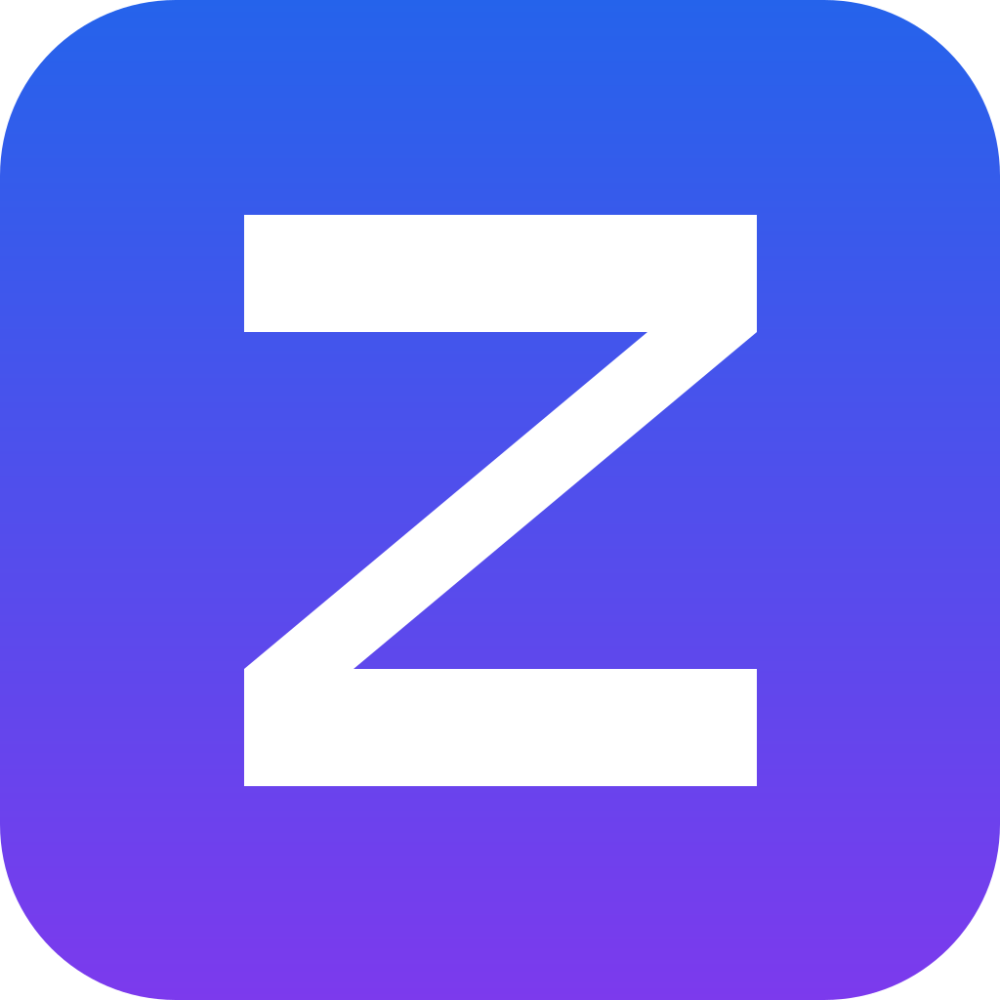
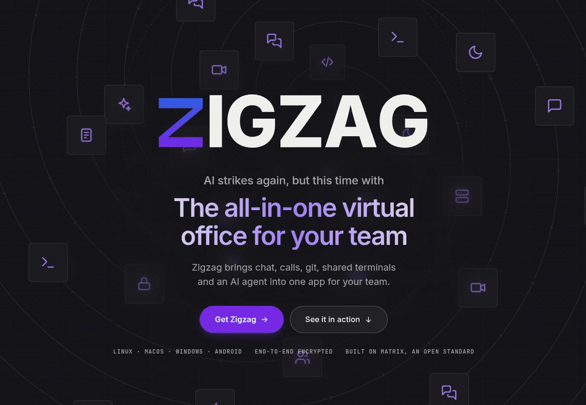
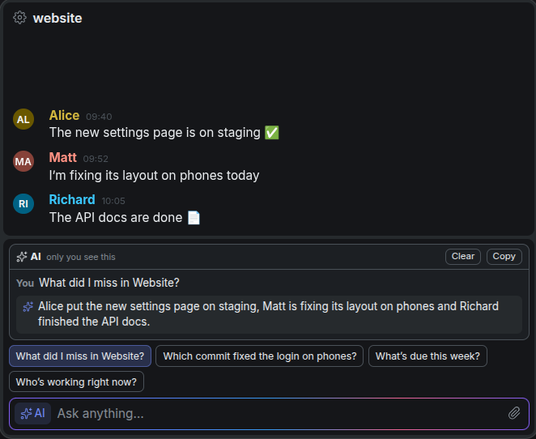
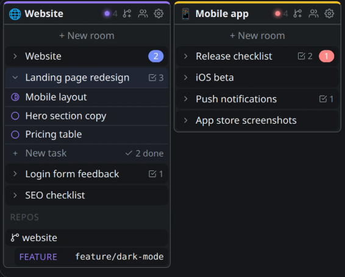
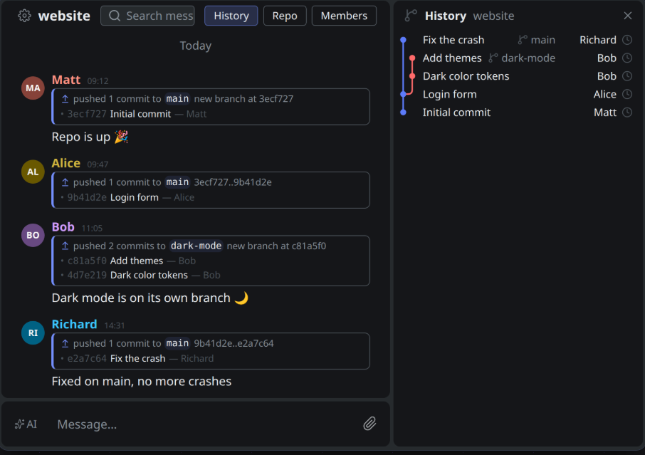
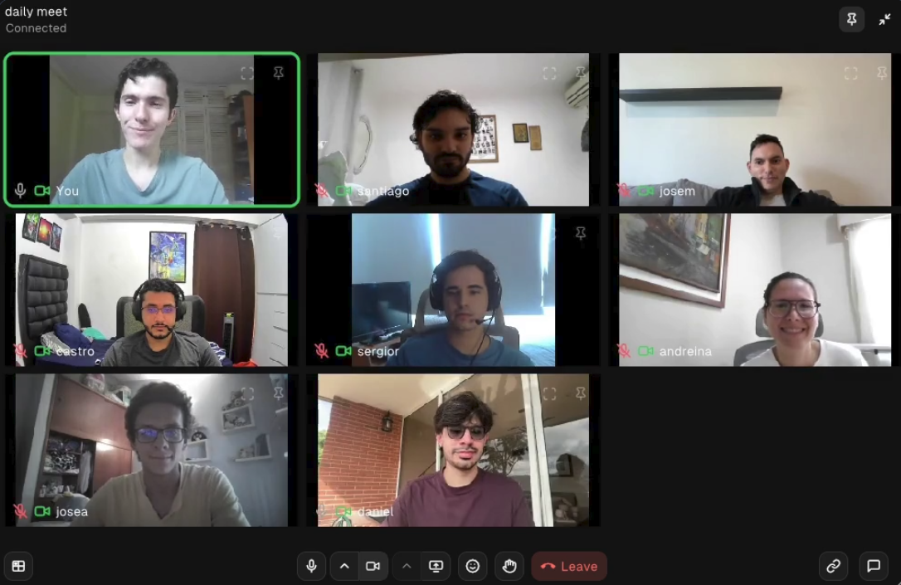
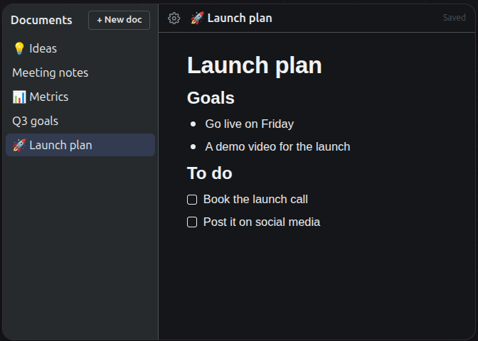
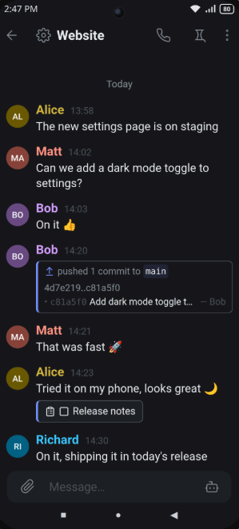

<h1 align="center">
   
  Zigzag
</h1>

  <!-- TODO: one-line tagline -->
  <em>One-line tagline goes here.</em>

  
  
  
  
  
  
  
  

<!-- Looping demo GIF, generated from .github/readme-assets/zigzag-demo.mp4 with ffmpeg -->

  

## What is Zigzag?

<!-- TODO: 2–3 sentences explaining the product and who it is for -->

## Features

### AI Agents
Every room has its own AI agent. Turn it on from the composer and ask in plain language. It reads your rooms, documents, tasks and code, and searches them by meaning, not just exact keywords. It can catch you up, create tasks, write documents and do anything you can do in Zigzag. Before taking any significant action, it shows you its plan and waits for your approval.

### Projects
A project holds everything for a single product, client or team. Projects contain rooms, and each room keeps one conversation in one place: its messages, files and calls. Each room also has its own tasks (who is doing what, by when, and how far along it is), shown alongside the conversation.

### Git Repositories
Zigzag includes a built-in Git server. Push with standard Git, and every commit appears in the conversation. Open a room for each branch, feature or bug, and import existing repositories from GitHub or Bitbucket with their full history. Teammates clone straight from their own Zigzag app, with no Git accounts or keys required, and moderators can push.

### Calls
Every room supports voice and video calls with screen sharing, and you can invite guests. During a call, you can send messages, react or raise your hand without interrupting. The call appears in the room's conversation, so anyone can see it is live and join with one click.

### Documents
Write and edit notes, plans and meeting minutes together, and see each other's changes in real time. Pages are built from blocks: headings, text, lists, checklists, quotes and code. Each document has its own emoji and its own invited members. Documents live in their own space, alongside your projects and chats.

## Download

Zigzag runs on desktop and mobile.

| Platform | Download |
| --- | --- |
| Windows | [Latest release](https://github.com/klauss194/zigzag/releases/latest) |
| macOS | [Latest release](https://github.com/klauss194/zigzag/releases/latest) |
| Linux | [Latest release](https://github.com/klauss194/zigzag/releases/latest) |
| Android | [Latest release](https://github.com/klauss194/zigzag/releases/latest) |
| iOS | [Latest release](https://github.com/klauss194/zigzag/releases/latest) |

<!-- TODO: once release asset names are stable, link directly:
     https://github.com/klauss194/zigzag/releases/latest/download/<asset-name>
     TODO: if mobile ships through Google Play / App Store / TestFlight, replace the Android and iOS links (table and badges) -->

## License

Licensed under your choice of the PolyForm Strict License 1.0.0 or the PolyForm Free Trial License 1.0.0. See [LICENSE](LICENSE).
